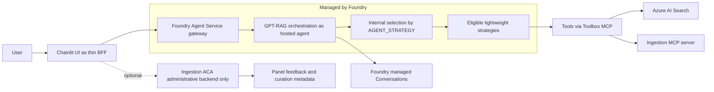
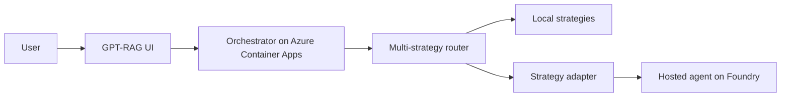

# ADR-0001: How GPT-RAG will support Microsoft Foundry hosted agents

Status: Accepted (revision 5, hosted-default promotion approved; default-changing
release gated by issues #591, #592, #597, and #589; panel separately gated by
#611)
Date: 2026-08-05
Deciders: Paulo (GPT-RAG maintainer), with architecture analysis (Martin) and
implementation analysis (Guido).

> Native-runtime revision: [ADR-0034](ADR-0034-native-agent-and-workflow-hosting.md)
> supersedes the stateless Hosted adapter and classic-only execution assumptions
> for the new native MAF runtime. The historical decisions and evidence below
> remain applicable to deployments using their original component combination.
> Identity and document-authorization requirements are retained.

## TL;DR (one sentence)

We decided that fresh GPT-RAG deployments will use Microsoft Foundry hosted
orchestration by default, without the administrative panel, while Azure
Container Apps remains an explicit, supported fallback and existing deployments
do not switch runtimes during upgrade without operator consent.

Non-negotiable requirement: Option 1 is only acceptable if it preserves,
end to end, the native document-level security provided by Foundry IQ and Azure
AI Search, with each user seeing only what they are allowed to see.

## Decision history

The first version of this ADR chose Option 2 (the orchestrator stays on
Container Apps and only consumes hosted agents as sub-agents). The decision was
reversed after a conversation with the field. The argument that turned the
table: customers want hosted agents as an alternative to Azure Container Apps,
not as one more piece on top of what already exists. In other words, the work is
not to add capability, it is to replace the orchestrator compute resource. Under
that framing Option 2 does not deliver what the customer asks for, because it
keeps Container Apps running. Only Option 1 removes a resource from the operator
bill.

Revision 5 changes the promotion policy, not the runtime architecture. Revisions
1 through 4 made hosted/no-panel an opt-in preview and kept Container Apps as the
default. After the hosted implementation and exact component pins landed through
PR #614, the maintainer explicitly chose hosted/no-panel as the future default
for fresh deployments. This revision supersedes earlier default/opt-in language
in this ADR. It does not change an implementation default, deploy Azure
resources, update the published documentation, or publish a release by itself.
Revision 4 remains the implementation boundary implemented by issue #595.

## Revision 5: hosted-default promotion contract

### Prioritized architectural characteristics

The characteristics below are ordered. A lower-priority benefit cannot waive a
higher-priority gate.

1. **Document authorization and identity integrity.** The hosted path must prove
   an authorized-user allow and unauthorized-user deny through UI, hosted agent,
   Toolbox, Foundry IQ, and Azure AI Search. The signed-in user uses delegated
   authorization; managed identity or a group-filter fallback is not acceptable
   evidence for the default path. Bearer tokens and protected content must be
   absent from logs.
2. **Chat correctness and fail-closed behavior.** Responses streaming, two-turn
   managed Conversation continuity, citations, correlation, and the supported
   strategy set must work without an orchestrator Container App. Missing caller
   context, identity, endpoint, or downstream authorization fails explicitly;
   the UI never silently changes to Container Apps.
3. **Safe deployment and upgrade compatibility.** A fresh Basic deployment and
   a fresh network-isolated deployment must select hosted/no-panel without extra
   mode flags, deploy no orchestrator Container App, and use immutable component
   and image digests. Existing environments remain on their persisted topology
   during upgrade until an operator runs the documented migration.
4. **Operability and reversibility.** Container Apps remains maintained,
   tested, documented, and selectable with one explicit topology setting. A
   fallback redeploy must restore classic chat without deleting hosted
   Conversations or panel data and without hand-editing App Configuration.
5. **Cost and operator burden.** Hosted/no-panel removes the always-deployed
   orchestrator Container App and panel-only Cosmos dependency. Release evidence
   must disclose Foundry session pricing, measured cold/resume behavior, and a
   representative hosted-versus-classic cost comparison rather than assuming
   that fewer resources always means lower total cost.

### Alternatives considered for the product default

| Alternative | Benefits | Costs and risks | Identity, network, compatibility, and reversibility |
| --- | --- | --- | --- |
| Keep Container Apps as the default | Lowest migration risk; current OBO, panel, and operational model remain unchanged. | Does not deliver the intended managed-agent experience or remove the orchestrator resource; hosted remains easy to miss and under-exercised. | Strongest current compatibility. Hosted security and private-build paths stay secondary. Reversal is trivial because nothing changes. |
| **Hosted/no-panel by default, Container Apps as explicit fallback (chosen)** | Makes the managed Foundry runtime the normal fresh-deploy experience, removes the orchestrator Container App, and keeps a recovery path. | Puts hosted preview constraints, per-session limits, immutable 100% traffic switching, and Foundry pricing on the default path. Requires sticky upgrade semantics and two runtimes to remain supportable. | Requires delegated caller identity through Toolbox and negative authorization proof; requires a validated private ACR build/pull route; preserves existing deployments and supports explicit fallback. |
| Hosted-only | Simplest long-term topology and smallest runtime support matrix. | Removes the proven recovery path while hosted agents have no SLA, no canary, strict resource ceilings, and incomplete panel support. Existing deployments would face a forced migration. | Unacceptable until hosted operation, identity, strategy compatibility, and panel parity have substantially stronger evidence. Reversal would require reintroducing a removed runtime. |

### Default, migration, and configuration semantics

- The target default for a **new environment created after the default-changing
  release** is hosted/no-panel:
  `DEPLOY_HOSTED_AGENT_ORCHESTRATION=true`,
  `DEPLOY_ADMINISTRATIVE_PANEL=false`, `CHAT_BACKEND=hosted_agent`.
- `DEPLOY_ADMINISTRATIVE_PANEL` remains `false` by default and must fail
  validation if enabled in a release until #611 closes with the managed
  Conversation history, feedback, curation, dashboard, identity, and live
  hosted/panel gates.
- Container Apps remains the explicit fallback:
  `DEPLOY_HOSTED_AGENT_ORCHESTRATION=false`,
  `DEPLOY_ADMINISTRATIVE_PANEL=false`, `CHAT_BACKEND=orchestrator`.
- An existing environment with a persisted classic topology must not become
  hosted merely because a template or environment-variable fallback changes.
  Before the default changes, the umbrella implementation must materialize or
  infer an explicit sticky topology from the deployed `DEPLOYMENT_TOPOLOGY` and
  App Configuration state. Valid topology values remain `classic`,
  `hosted-no-panel`, and `hosted-panel`. An existing deployment with no topology
  marker is treated as pre-cutover `classic`; genuinely conflicting persisted
  signals fail with migration guidance.
- Migration is an operator action that validates prerequisites, pins the hosted
  image digest, changes the topology, provisions/deploys hosted/no-panel, proves
  a smoke request, and only then removes or deactivates the classic chat path.
  No Cosmos-to-Foundry history backfill is required; classic history remains
  readable in the fallback deployment and new hosted history starts in Foundry
  managed Conversations.
- Runtime failure never causes an automatic cross-backend fallback. That would
  change identity, authorization, conversation, and cost semantics inside a
  user request. Rollback is an explicit deployment operation.

### Repository and contract handoff

| Repository | Required implementation handoff before the default changes |
| --- | --- |
| `Azure/GPT-RAG` | Own fresh-versus-existing topology selection, sticky upgrade detection, paired PowerShell/shell lifecycle behavior, `main.parameters.json`, App Configuration publication, immutable manifest pins, hosted image orchestration, rollback contract, release tests, and the later docs/release handoff. The AI Landing Zone stays accelerator-neutral. |
| `Azure/gpt-rag-ui` | Make `hosted_agent` the fresh-deploy backend selected from App Configuration; call the hosted endpoint as the trusted UI BFF and derive `x-ms-user-identity` only from its authenticated server-side principal; keep OBO tokens separate and limited to retrieval authorization; preserve explicit `orchestrator` fallback; stream Responses and map managed response IDs; fail closed with no silent backend fallback. Keep panel surfaces disabled until #611. |
| `Azure/gpt-rag-orchestrator` | Maintain the runtime-neutral core and both adapters; publish/run the hosted entrypoint from an immutable image; propagate only the opaque Foundry call context to Toolbox; preserve managed Conversations, bounds, timeouts, telemetry redaction, and the eligible-strategy gates; keep the classic adapter release-compatible. |
| `Azure/gpt-rag-ingestion` | Keep hosted retrieval behind the delegated-token, identity-aware, fail-closed contract and INV-002 evidence; preserve document ACL metadata and bounded outputs. Do not promote draft panel/history endpoints before #611. |
| `Azure/bicep-ptn-aiml-landing-zone` | Continue to expose generic hosted-agent, private networking, RBAC, private ACR pull, and dedicated VNet-connected ACR Tasks pool primitives. Complete and release the private-network naming/build fixes required by #597, but do not encode GPT-RAG's product default. |
| `Azure/GPT-RAG` `docs` branch | In the implementation/release change, replace current opt-in guidance with fresh-deploy, existing-upgrade, migration, cost, rollback, and no-panel-default guidance. Do not claim hosted/panel support before #611. |

`Azure/gpt-rag-mcp` (legacy repository; not renamed under the Agent Landing Zone rebrand) is not on the current default-change critical path. Add it
only if the validated Toolbox contract requires a runtime change in that
repository.

### Fitness functions and promotion gates

| Priority | Fitness function | Passing evidence |
| --- | --- | --- |
| P0 | Delegated authorization is preserved end to end. | #591 closes with isolated two-user/two-group allow and deny tests through chat, citations, Toolbox/retrieval, and direct citation access; malformed/missing context fails closed; token/protected-content log scans are clean. |
| P0 | Hosted/no-panel serves correct chat behavior. | #592 closes with Responses streaming, two-turn managed Conversation continuity, correlation, supported-strategy smoke coverage, and zero orchestrator Container Apps. |
| P0 | Private deployment and immutable image operation work. | #597 closes with fresh network-isolated provision, dedicated VNet-connected ACR Tasks build, private Foundry image pull with ACR public access disabled, digest verification, previous-version rollback, and cleanup. |
| P1 | Fresh and upgrade semantics are deterministic. | Contract tests prove fresh Basic and isolated environments select hosted/no-panel; fixtures for pre-cutover classic environments remain classic; ambiguous state fails; explicit fallback recreates classic in one deployment cycle without data deletion. |
| P1 | Cross-platform and cross-repository contracts agree. | PowerShell/shell parity tests pass; exact released component commits and AILZ tag are pinned; UI, orchestrator, ingestion, and umbrella contract suites pass at those pins. |
| P2 | Resource bounds and cost are understood. | Each enabled strategy meets the existing startup, idle/resume, concurrency, and memory gates; release evidence publishes a representative Foundry-session versus classic cost comparison and identifies preview/SLA limits. Cost is a disclosure and explicit maintainer-approval gate, not a universal savings threshold; no savings claim is made unless the measured profile supports it. |
| P2 | Operator guidance matches the release. | #589 updates the `docs` branch and release material after the implementation lands; docs explicitly keep the panel off until #611 and include migration and fallback procedures. |

### Adoption order

1. Merge this ADR-only revision. It authorizes no runtime-default change.
2. Close the live security, runtime, and private-network evidence gaps in #591,
   #592, and #597 using exact immutable component pins.
3. Release and pin any required component and AI Landing Zone fixes with human
   approval.
4. Implement the umbrella fresh-default and sticky-upgrade contracts in a
   separate focused change; keep `DEPLOY_ADMINISTRATIVE_PANEL=false`.
5. Validate the exact integrated combination in fresh Basic, fresh isolated,
   pre-cutover classic upgrade, explicit migration, and explicit fallback
   scenarios.
6. Update the `docs` branch and prepare the release through #589. Only that
   release changes the supported product default.
7. Complete and independently promote hosted/panel through #611; it is not a
   prerequisite for hosted/no-panel to become the chat default.

### Open blockers at acceptance of revision 5

- #591 remains open until the exact released pins pass the isolated delegated
  identity and two-user document-authorization proof.
- #592 remains open until the corrected hosted/no-panel runtime passes the
  minimal live streaming, managed Conversation continuity, telemetry, rollback,
  and cleanup sequence.
- #597 remains open until the private ACR route, dedicated VNet-connected ACR
  Tasks pool, hosted derivative image, private pull, and digest rollback pass
  together. Any required AI Landing Zone fix must be independently reviewed,
  released, and pinned before it counts as evidence.
- #589 remains the documentation and umbrella-release gate. The published docs
  currently describe Container Apps as the default and hosted/no-panel as an
  opt-in preview; that is accurate until the implementation and release change.
- #611 blocks only hosted/panel. It requires the managed Conversation history
  API, panel frontend, feedback/curation contract, fail-closed identity behavior,
  exact pins, and live validation. The panel flag stays false until it closes.
- #576 remains the parent delivery record and should close only after the
  hosted-default release evidence is complete.

## Context and problem

Before deciding anything we need to agree on vocabulary, because the word "agent"
is overloaded.

A hosted agent, in Microsoft's strict sense, is your agent code packaged into a
container and run by the Foundry Agent Service. The platform handles the
runtime, scaling, session state, identity, and observability. You program the
behavior, the platform operates the rest.

That is different from a prompt agent, which is a declarative agent created in
the portal and consumed by id or name. Prompt agents are out of scope for this
decision. Here we only mean the strict sense: code in a container, managed by
Foundry.

To ground this in what exists today: the integrated candidate pins the GPT-RAG
orchestrator (repository Azure/gpt-rag-orchestrator, version 3.10.0, Python with
FastAPI), which supports both Container Apps and hosted adapters and has a
multi-strategy router. It selects the strategy through a configuration called
AGENT_STRATEGY, and there are already strategies built on Microsoft Agent
Framework (maf_lite, maf_agent_service) and on Semantic Kernel
(single_agent_rag, mcp, nl2sql, multimodal). The UI (repository gpt-rag-ui, a
Chainlit app in Python) receives the response as a stream, and there are also
routes for conversation history, feedback, and an administrative dashboard.
Keep these details in mind, because they weigh on the design.

An important finding from the code review: the maf_agent_service strategy
already publishes to the Foundry Agent Service declaratively, with create_version
and PromptAgentDefinition, and already runs on the Responses runtime via the
Microsoft Agent Framework ChatAgent. It already integrates OBO and MCP. This
means the starting point for becoming a hosted agent already exists inside the
repository, it is not starting from zero.

## The two ways to do it

There are two ways to connect GPT-RAG to the world of hosted agents. They are
almost opposite.

### Option 1: BE a hosted agent (chosen)

We package the GPT-RAG orchestration core as a hosted agent and let Foundry host
and manage the runtime. The agent exposes the protocols Foundry expects
(Responses and Invocations). The UI now talks to this agent for chat. The
orchestrator Azure Container Apps stops being mandatory and remains the explicit
classic fallback. A smaller administrative backend may be added later, but the
panel path is disabled until #611 closes.

The analogy is moving into a fully serviced furnished apartment. The building
handles maintenance, front-desk security, and infrastructure. In exchange you
accept the building rules: the size of the apartment and what you can and cannot
install. You give up some control and gain one less resource to maintain.

### Option 2: CONSUME hosted agents (discarded)

The orchestrator would stay on Azure Container Apps with today's multi-strategy
router, and would start calling external hosted agents as sub-agents. It is low
risk and additive, but it keeps Container Apps running, which is exactly the
resource the customer wants to eliminate. That is why it was discarded as the
main direction.

## The Option 1 design, in detail

This is the heart of the ADR. These are the answers to the questions Option 1
opens.

### Runtime-agnostic adapter boundary

The central recommendation is to extract the orchestration core (the strategies)
into a library that does not know the runtime, behind a stable contract, for
example a handle_turn function that takes the request and returns a stream of
events. On top of that library sit two thin adapters: a FastAPI adapter (today's
/orchestrator SSE endpoint, for the Container Apps mode) and a Responses adapter
(using azure-ai-agentserver-responses, for the hosted agent). What is specific to
Foundry stays isolated in the Responses adapter. The repository already has a
contracts folder with a versioned audit event schema, so there is precedent for
this. This adapter is the investment that protects both modes and avoids
rewriting business logic.

### Strategies are preserved, the runtime change is plumbing not logic

An explicit design principle: we are not deleting strategies to become a hosted
agent. The six strategies stay. The reasoning core of each strategy is meant to
be runtime-agnostic, which is exactly what the adapter boundary delivers. Moving
to the hosted agent runtime changes the plumbing around the strategies, not the
strategy reasoning. Concretely, the plumbing that changes is: the adapter
boundary, moving history and feedback persistence out of the ACA-coupled
orchestrator, the identity and retrieval path so document-level security still
works when the user token does not reach the container, and routing tools through
the Toolbox. That plumbing cost is paid once, and it is roughly the same whether
we keep six strategies or one, so keeping them is not what drives the migration
cost. Any later consolidation (folding single_agent_rag and mcp into the base,
reclassifying nl2sql and multimodal as composable tools or connected agents) is
optional future cleanup, not a prerequisite to ship.

### Multi-strategy routing: one agent with internal selection

We chose to publish a single hosted agent that loads the eligible strategies and
selects by AGENT_STRATEGY at the version level. This realizes the "one less
resource" the field asked for and avoids reintroducing a separate router. We are
not going to publish one agent per strategy as the default, because that
multiplies operational cost and recreates the fragmentation we want to avoid.
Eligible at the start are the lightweight strategies: maf_lite,
maf_agent_service, single_agent_rag, and mcp. The heavy strategies, nl2sql and
multimodal, are handled separately (see resource ceiling). A hybrid mode, with a
heavy strategy isolated in its own agent, is reserved only if profiling shows the
need.

### UI: Chainlit as a thin BFF, not the browser directly

The browser should not speak Responses directly. That path requires confidential
client Entra authentication, secret handling, SSE streaming, and CORS, things
that do not safely fit in the client. The gpt-rag-ui UI is already a Chainlit app
with a server-side Python backend, and it already centralizes the conversation
with the orchestrator in orchestrator_client.py. We keep Chainlit as a thin edge
proxy, a BFF, that speaks Responses with the hosted agent and turns the response
into chunks for the screen. This BFF is not the old orchestrator: it has no
strategies and no retrieval, it only mediates auth, the token with the right
audience, streaming, and the conversation id mapping. In code, this is an
evolution of orchestrator_client.py, with a new path selected by configuration
(for example CHAT_BACKEND equal to hosted_agent), without spreading branches
across the app.

### Non-conversational routes: history, feedback, and panel

The code already separates these routes from the chat flow. The recommendation
is:
- Basic conversation history moves to Foundry managed Conversations, which are
  durable and independent of the compute. That way history survives even without
  Container Apps.
- Feedback, the administrative panel, and the dashboard stay on the optional,
  smaller Container Apps, with Cosmos, provisioned only when the panel is turned
  on.
- Code caveat: today conversation and feedback persistence is coupled to the chat
  flow inside orchestration/orchestrator.py. For Container Apps to be truly
  optional, history and feedback writes need to move into the hosted agent,
  leaving Container Apps with read and curation only. This is a refactoring task
  to validate.

Naming note: the optional Container Apps serves the administrative panel
(history, feedback, and dashboard). The term "curation" only appears when we mean
the activity of reviewing content inside that panel.

### The provisioning flag

Two flags in the format the infra already uses (deployXxx with a value coming
from an environment variable) select the topology:
- DEPLOY_HOSTED_AGENT_ORCHESTRATION. The implemented baseline defaults to false
  today. The default-changing release will set it to true only for fresh
  environments and preserve an existing environment's persisted topology.
- DEPLOY_ADMINISTRATIVE_PANEL, default false. When true in hosted agent mode,
  brings up the smaller Container Apps only to serve history, feedback, and the
  dashboard. It is supported by the coordinated hosted-panel release matrix;
  its history and operator surfaces remain independently disabled by default
  and fail closed until their explicit evidence/configuration gates are met.

Three resulting modes:
- Classic (explicit fallback, and sticky for existing classic environments):
  hosted agent off. Orchestrator on Container Apps and UI talks to it.
- Hosted agent without panel (target default for fresh environments): flag on,
  panel off. The hosted agent comes up, the
  UI points at it, the orchestrator Container Apps does not come up, history via
  Foundry Conversations. This is the field's "one less resource".
- Hosted agent with panel: flag on, panel on. Hosted agent
  for chat, smaller data-ingestion Container Apps only as the administrative
  backend.

At deployment time Azure/GPT-RAG composes the landing-zone parameter document,
then deploys the agent through an isolated `azure.ai.agent` service only when
hosted mode is selected.

### Implemented accelerator and landing-zone boundary

Issue #595 fixes the ownership boundary rather than putting product policy into
the reusable landing zone:

- Azure/GPT-RAG owns `DEPLOY_HOSTED_AGENT_ORCHESTRATION` and
  `DEPLOY_ADMINISTRATIVE_PANEL`. The implemented revision-4 baseline defaults
  both to `false`; revision 5 requires hosted/no-panel for fresh environments,
  sticky topology for upgrades, and keeps the panel default `false`. Its
  pre-provision composer converts those flags into the three resource
  compositions.
- The AI Landing Zone remains accelerator-neutral. Version `v2.4.1` accepts the
  generic hosted-agent inputs, provisions the shared Foundry and registry
  prerequisites, and returns handoff outputs. It does not choose GPT-RAG's mode,
  remove Container Apps, select components, or publish GPT-RAG runtime keys.
- Classic mode retains the orchestrator, UI, and ingestion Container Apps plus
  Cosmos. Hosted/no-panel omits the orchestrator Container Apps and panel-only
  Cosmos. Hosted/panel still omits the orchestrator Container Apps; chat stays on
  the hosted agent while the ingestion app provides the administrative backend
  and Cosmos-backed feedback/curation APIs.
- The hosted agent has an isolated child `azure.yaml` project. This prevents a
  normal root `azd deploy` from deploying a hosted agent in classic mode.
- GPT-RAG publishes `CHAT_BACKEND`, both classic and hosted endpoint references,
  the mode flags, and `DEPLOYMENT_TOPOLOGY` under the `gpt-rag` App Configuration
  label. The hosted base URL is derived from azd's Invocations protocol endpoint
  so the UI can append `/invocations` without duplicating that path.
- Hosted mode requires `HOSTED_AGENT_IMAGE_VERSION` to be an immutable
  `sha256:<digest>`. A mutable release tag is rejected. The implemented baseline
  accepts an operator-supplied digest; before hosted becomes the fresh default,
  deployment must automatically resolve or build a hosted-ready immutable image
  so a fresh deployment does not depend on an undocumented manual prerequisite.
- The published orchestrator image's baked-in entrypoint is the classic
  Container Apps command. Foundry's container-mode hosted-agent API deploys
  whatever `CMD`/`ENTRYPOINT` is in the image and does not read `azure.yaml`'s
  `startupCommand`, so pointing `HOSTED_AGENT_IMAGE_VERSION` straight at the
  classic image's digest starts the wrong process. Setting
  `HOSTED_AGENT_AUTO_BUILD_IMAGE=true` (default `false`) makes `preDeploy`
  derive a hosted-specific image first: an ACR Tasks build, using the same
  private registry and agent pool as every other network-isolated build, whose
  only instructions are `FROM <the pinned classic digest>` plus a `CMD`
  override to the hosted entrypoint. `HOSTED_AGENT_IMAGE_VERSION` is then
  re-pinned to the derivative image's digest before `azd deploy
  orchestrator-agent` runs. Operators who already publish a correctly
  configured hosted image can leave the flag off. The default-changing release
  must either select this automatic build path or pin a published image whose
  baked-in entrypoint already satisfies the hosted contract.
- The deterministic rollback contract restores the complete `v3.7.0` classic
  pin set, resets both flags to `false`, clears hosted endpoint inputs, and
  restores `CHAT_BACKEND=orchestrator`.

No files inside the landing-zone submodule are changed by this implementation.
The integration was limited to the exact `v2.4.1` tag/gitlink and its published
parameter/output contract at the time revision 4 was implemented.

> **Landing-zone pin in effect.** The versions named in this section record the
> revision-4 implementation boundary and are deliberately not rewritten per
> release. For the pin actually in effect, read `manifest.json` (`ailz_tag`,
> `ailz_commit`) together with `.gitmodules` (`infra.branch`); those three must
> identify the same validated landing-zone release commit.

### Hosted conversation ownership

Live OQ-OWN evidence changes the continuity decision from capability-first to
delegated ownership. The trusted UI BFF calls the hosted Responses 2.0.0
endpoint with `x-ms-user-identity`, derived only from the authenticated
server-side user principal. The header is an opaque Foundry conversation
partition key. It is not browser input and it is not an OBO retrieval token.
OBO remains a separate downstream authorization flow for Foundry IQ, Toolbox,
and document-level retrieval.

The UI BFF receives Foundry Agent Consumer
(`eed3b665-ab3a-47b6-8f48-c9382fb1dad6`) and the GPT-RAG custom
user-identity impersonation role
(`bef66abe-a495-530a-be1d-5d882fecff03`) directly at the individual hosted
agent scope. The custom role has no `Actions` and exactly
`Microsoft.CognitiveServices/accounts/AIServices/agents/endpoints/UserIdentityImpersonation/action`
as its only `DataAction`. Foundry User, Project Runtime User, inherited/group
assignments, and broader scopes are not approved substitutes. The hosted
container receives neither role.

Continuity remains disabled with an HTTP 503 runtime contract until setup
confirms the live routed Responses protocol is exactly 2.0.0 and both direct
role assignments match. The HMAC capability envelope remains a disabled,
explicit fallback. Delegated mode provisions no capability vault, secret,
secret role, key, or App Configuration reference.

### User identity and document-level security

This is the most delicate part of Option 1, so it is worth explaining from the
start.

How it works today, on Container Apps. The user logs in to the UI with their
Entra account. The UI sends the request to the orchestrator along with the user
token, in an HTTP header called Authorization. The orchestrator uses that token
to do OBO (on-behalf-of): it exchanges the user token for a token to talk to
Azure AI Search as that user. So Search only returns the documents that person is
allowed to see. That is what we call per-user trimming, or document-level
security.

What changes in hosted agent mode. Now the request goes from the UI to the
Foundry gateway and only then to your container. That gateway, for security,
drops most of the caller headers before handing the request to the container, and
Authorization is among the ones it drops. Practical consequence: the user token
does not enter the container. So the agent cannot repeat that same OBO from
before, because it does not have the user token in hand.

Why it matters. If the user identity does not reach the moment of the search,
trimming is lost and everyone would start seeing everything. Our requirement is
the opposite: Option 1 has to keep respecting the native document-level security
of Foundry IQ and Azure AI Search. Native means Search itself decides what the
person can see, comparing the user's Entra groups against the permissions stored
on each document. It is not us filtering by hand, it is the platform making the
cut. For that to work, Search needs to receive the user identity at query time.

In other words, the real problem is not "recreate OBO in the agent". It is to
make sure the user identity reaches Search so the native mechanism trims the
results. We design this in two paths, in order of preference.

- Target path, native security via Foundry IQ with identity passthrough. The
  search tools enter through the Toolbox (MCP), which is the only supported way
  to give tools to the hosted agent, and the Toolbox knows how to forward the
  user's OAuth identity onward. With that, the query to Foundry IQ carries the
  person's identity, and Search applies native trimming on its own, using the
  user's groups against the document permissions. It is the cleanest path,
  because we write no filter code, we just reuse what the platform already does.
  This is the target of the design.
- Fallback controlled by GPT-RAG, in case native identity passthrough does not
  close in preview. The UI, which has the user identity, looks up the person's
  groups in Microsoft Graph and sends a group filter to the agent, in an allowed
  header (x-client-*) or in the request body. The agent forwards that filter on
  the query to Search. It is still Search applying the cut, but the one who
  discovers the groups is the UI, not the platform. It serves as a safety net
  while we validate the native path.

Acceptance requirement: Option 1 is only considered done when the native
document-level security of Foundry IQ and AI Search works end to end through the
target path, with a user without permission unable to see the restricted
document. Validating this with two users from different groups is a mandatory
item before promoting the hosted agent mode.

The code that touches this already exists and shortens the work: search.py
(acquire_obo_token, conversation filter), maf_agent_service_strategy.py (the
request token), and mcp_client.py (the user-context header). Foundry IQ uses
metadata_security_id and rbacScope for trimming, which is exactly the native
piece we want to keep in charge.

### Resource ceiling and the heavy strategies

Session sizes range from 0.5 vCPU / 1 GiB up to a maximum of 2 vCPU / 4 GiB, per
session, and billing sums the active sessions. Orchestration is I/O bound, the
heavy work runs on Azure OpenAI and on Search, so the lightweight strategies
(single_agent_rag, maf_lite, maf_agent_service, mcp) and also nl2sql tend to fit.
The real risk is multimodal, because of image decoding, large base64, and
multiple images. Mitigation: push multimodal preprocessing to ingestion or to a
Toolbox tool, prefer streaming over buffering, and isolate multimodal in its own
agent only if profiling requires it.

### Zero Trust and the private ACR

Foundry can run network-isolated, with egress through the customer VNet and
private endpoints to Search, Cosmos, SQL, Storage, Key Vault, Foundry, and Azure
OpenAI. The UI and the panel Container Apps sit in the VNet behind Front Door or
Application Gateway with WAF. Brazil South is among the supported regions.

One point that needs to be explicit and correct, because the previous version of
this ADR got it wrong: support for the ACR (Azure Container Registry, where the
container image lives) behind a private endpoint with public access disabled
depends on the Foundry project creation date. Projects created after June 25,
2026 support a private ACR. Projects created before that date need the ACR to be
reachable through the public endpoint so the platform can pull the image. On top
of that, with a private ACR, the azd up that builds and pushes the image and
creates the agent version needs to run from inside the VNet, through a CI runner
or jumpbox, or use ACR Tasks. This is not a blocker, but it is a concrete
environment constraint that goes into planning.

## Advantages and disadvantages

### Option 1, being a hosted agent

Advantages:
- One less resource for the customer to operate. The orchestrator Container Apps
  leaves the bill in the no-panel mode.
- Runtime, scaling, session state, agent identity, versioning, and observability
  come ready from the platform.
- Aligns the project with Foundry's official path for agents.
- The starting point already exists in code (maf_agent_service already uses the
  declarative Agent Service and the Responses runtime).

Disadvantages:
- It is a boundary refactor. The core needs to be extracted into a library behind
  adapters, and history and feedback persistence needs to move into the agent.
- The user token does not reach the container, so document-level security has to
  be preserved through the native Foundry IQ path with identity passthrough via
  the Toolbox, with the group filter as a fallback.
- The 2 vCPU and 4 GiB per-session ceiling now applies to orchestration, which
  squeezes multimodal.
- It puts a preview runtime on the critical path. No SLA, no native canary, and
  rollback is reverting to a previous version.

### Option 2, consuming hosted agents

Advantages:
- Low risk and additive, what already works keeps working.
- Lands on the canonical extension point, a new strategy.

Disadvantages:
- It does not deliver what the customer asks for, because it keeps Container Apps
  running.
- It adds a network hop and keeps the cost of operating the orchestrator.

### Comparison table

| Axis | Option 1: BE a hosted agent (chosen) | Option 2: CONSUME hosted agents |
| --- | --- | --- |
| Delivers the field request | Yes, removes Container Apps from the bill | No, keeps Container Apps |
| Effort and risk | High, refactors the boundary and persistence | Low, lands as a new strategy |
| Zero Trust and network | Depends on Foundry networking, with the ACR date lock | Keeps current network and rules |
| Document-level security | Token does not reach the container, preserves the native cut via Foundry IQ and Toolbox, group fallback | User token already arrives, classic OBO directly |
| Operational cost | Less infra in the no-panel mode | Still operates the orchestrator |
| Scale and limits | The 2 vCPU and 4 GiB ceiling applies to orchestration | The ceiling only affects the sub-agent |
| Preview dependency | High, preview runtime on the critical path | Low, Responses and Invocations are GA |
| Reversibility | Keep the classic mode as fallback via the flag | Easy, on and off per strategy |

## What the official documentation confirmed

Three facts were checked in the official documentation on 2026-07-21 and enter as
base truth for this decision. Two of them correct claims from the previous
version.

- The private ACR has a per-project date lock. Corrects the previous version,
  which said the lock had been lifted. Support for an ACR behind a private
  endpoint with public access disabled only applies to projects created after
  2026-06-25. Earlier projects require the ACR reachable through the public
  endpoint.
- The gateway drops caller headers outside a fixed set. This keeps Authorization
  and credentials out of the container. Direct consequence: on the path from the
  UI to the hosted agent, the user token does not arrive as a bearer. That is why
  document-level security now depends on the native cut of Foundry IQ and AI
  Search with the identity forwarded by the Toolbox, and on the group filter as a
  fallback.
- Versions are immutable and the endpoint serves one version with 100% of the
  traffic. There is no native traffic splitting, no canary, no blue-green.
  Updating means publishing a new version and switching. Rollback is reverting to
  the previous version.

What still holds: the 2 vCPU and 4 GiB per-session ceiling, hosted agents in
preview without SLA, and tools only via the Toolbox MCP.

## Decision

We are going with Option 1, in the mode designed above: the orchestration becomes
a hosted agent, the Chainlit UI talks to it as a thin BFF, and the orchestrator
Azure Container Apps becomes an explicit supported fallback. Fresh environments
select hosted/no-panel after the promotion gates pass. Existing environments
retain their persisted topology, and the administrative panel stays off until
#611.

The why, in plain terms:
- Delivers what the field asked for: one less resource for the customer to
  operate.
- Concentrates the runtime in Foundry, with managed scaling, state, identity, and
  versioning.
- Reuses what already exists in code, because maf_agent_service already talks to
  the Agent Service declaratively.
- Keeps the classic Container Apps mode as a supported explicit fallback and
  protects existing deployments from an implicit runtime migration.

## Consequences

What we gain:
- A path to deliver the model the customer wants, with less infra to operate day
  to day.
- An adapter boundary that serves both modes and protects the investment.

What we give up:
- The user token arriving directly at the compute, which changes the security
  design of trimming.
- Part of the resource headroom, because the per-session ceiling now applies to
  orchestration.
- Having the whole critical path in GA, because hosted agents are in preview.

The thread running through it: regardless of the mode, GPT-RAG should formalize
the adapter boundary. It is what lets us serve the classic mode and the hosted
agent mode from the same logic, without rewriting anything when the preview turns
GA.

## Phased path

This is the architecture-level plan, in dependency order.

- Phase 1, orchestrator: extract the agentic core into a library behind adapters,
  starting from maf_agent_service, and decide the ownership of conversation and
  feedback persistence. Without this, nothing downstream works.
- Phase 2, infra and azd: introduce the flags, make the orchestrator Container
  Apps conditional, provision the hosted agent via azure.ai.agent, and write the
  chat backend and the agent endpoint into the configuration the UI reads.
  Depends on Phase 1 to have an agent image.
- Phase 3, UI: add the hosted_agent path in the BFF, adapt streaming and the
  conversation id to Responses, and keep history and feedback on the optional
  Container Apps. Depends on Phases 1 and 2.
- Phase 4, ingestion and Toolbox: register the MCP source in the Toolbox and
  validate connectivity and identity. Depends on Phase 2 for network and
  identity.
- Phase 5, identity and document-level security: close the identity passthrough
  and validate that the native cut of Foundry IQ and AI Search works end to end
  on the new path, with a test using two users from different groups. Depends on
  Phases 1, 3, and 4.

## Risks

- Preview without SLA on the critical path. Mitigation: make hosted the fresh
  default only after the P0 gates pass, preserve classic as an explicit
  supported fallback, keep existing deployments sticky, and document preview
  limits and recovery before release.
- Immutable version serving 100% of the traffic, no canary. Mitigation: publish
  and validate in a separate environment before switching the production version,
  and have the rollback by version reversal documented.
- Cold start with scale-to-zero after 15 minutes idle. The stated goal is to
  resume in under 1 second on microVMs, but being preview it needs to be
  validated with real load.
- Private ACR date lock. Zero Trust environments on older projects may need the
  public ACR, which must be checked in environment planning.

## Implementation contracts frozen for issue #588

The following decisions are frozen as repository-level contracts and release
gates for implementation tracks.

### Decision matrix

| Area | Frozen decision | Contract owner(s) | Release blocker if violated |
| --- | --- | --- | --- |
| History and feedback ownership | Hosted modes use Foundry managed Conversations for chat history. Feedback and administrative curation metadata remain in Cosmos and are only available when the administrative panel is deployed. | gpt-rag-orchestrator, gpt-rag-ui, Azure/GPT-RAG | Hosted/no-panel chat persistence falls back to orchestrator Container Apps instead of Foundry managed Conversations. |
| Identity propagation and fallback policy | Primary path is Toolbox identity passthrough so Foundry IQ and AI Search apply native document trimming. Group-filter fallback is allowed only as an explicit temporary override for preview environments and cannot be the default release path. | gpt-rag-orchestrator, gpt-rag-ui | Any unauthorized document retrieval on hosted path; fallback enabled by default in a release candidate. |
| Strategy eligibility under 2 vCPU / 4 GiB | The initial shared hosted-agent implementation scope is maf_lite, maf_agent_service, single_agent_rag, and mcp, subject to the hosted runtime gates below. nl2sql and multimodal remain classic-only until their investigations pass. | gpt-rag-orchestrator | nl2sql or multimodal enabled in the shared hosted agent without the required bounds, profiling evidence, and approval. |
| Chat/backend configuration contract | `CHAT_BACKEND` values remain `orchestrator` and `hosted_agent`. The default-changing release selects `hosted_agent` only for fresh environments and preserves the persisted selector for upgrades. `DEPLOY_ADMINISTRATIVE_PANEL` remains default `false`. App Configuration label `gpt-rag` must publish backend selector plus both endpoint outputs so the UI can switch through an explicit deployment operation. | Azure/GPT-RAG, gpt-rag-ui | Missing selector/endpoint outputs, ambiguous key ownership, implicit upgrade migration, or request-time backend fallback. |
| Administrative panel boundary | Hosted/no-panel mode provisions no orchestrator Container Apps. Hosted/panel mode retains the ingestion Container Apps as the panel-only administrative backend (history, feedback, dashboard) and does not route chat through Container Apps. | Azure/GPT-RAG, gpt-rag-ingestion, gpt-rag-ui | Any hosted deployment with orchestrator app provisioned; hosted/panel chat routed to Container Apps. |
| Private ACR build route | The network-isolated automated baseline is the dedicated VNet-connected ACR Tasks agent pool supplied by the AI Landing Zone. A VNet-connected self-hosted runner or jump host is a separately validated contingency, not an implicit bypass. Shared ACR Tasks cannot reach a private endpoint. | Azure/GPT-RAG, bicep-ptn-aiml-landing-zone | Dedicated-pool build or private Foundry pull is unproven, shared ACR Tasks are used for private ACR, or public ACR access is enabled as an implicit workaround. |
| Validation environment target | Validation must run in a dedicated non-production environment pair: one Basic topology and one network-isolated topology with private endpoints and private ACR support. | Azure/GPT-RAG | Hosted modes promoted without evidence from both topology classes. |

### Measurable release gates by topology

| Mode | Required evidence gates | Rollback trigger |
| --- | --- | --- |
| Classic (explicit fallback and sticky upgrade mode) | `DEPLOY_HOSTED_AGENT_ORCHESTRATION=false`; orchestrator Container Apps deployed; UI `CHAT_BACKEND=orchestrator`; regression checks for history and feedback pass; pre-cutover classic upgrade remains classic. | Any regression in classic chat, history, or feedback, or an existing deployment changes topology without operator migration. |
| Hosted / no-panel (fresh target default) | `DEPLOY_HOSTED_AGENT_ORCHESTRATION=true`, `DEPLOY_ADMINISTRATIVE_PANEL=false`; zero orchestrator Container Apps provisioned; UI `CHAT_BACKEND=hosted_agent`; two-user authorization negative test proves restricted user cannot retrieve protected content. | Unauthorized retrieval, missing hosted endpoint, orchestrator app unexpectedly provisioned, or silent runtime fallback. |
| Hosted / panel (issue #611 integration) | Explicit `DEPLOYMENT_TOPOLOGY=hosted-panel` materializes `DEPLOY_HOSTED_AGENT_ORCHESTRATION=true` and `DEPLOY_ADMINISTRATIVE_PANEL=true`; hosted compute serves chat while panel endpoints serve owner-bound history/feedback and authorized operator surfaces. Cosmos contains panel metadata only, and the independent history/operator evidence gates remain disabled until their live prerequisites pass. | Panel enabled by default; chat flow depends on Container Apps; hosted compute receives Conversations RBAC; panel APIs, owner binding, or operator authorization fail open or return success-shaped placeholders. |

Cross-cutting hosted runtime gates:

- Each enabled strategy must complete cold readiness within 30 seconds, survive
  one 15-minute idle/resume cycle, and stay below 2.5 GiB peak RSS under five
  representative concurrent requests. These are GPT-RAG release gates, not
  Microsoft platform guarantees.
- In-memory query results and image payloads must have explicit bounds.
- A network-isolated release must build and push from inside the VNet and prove
  that Foundry can pull the image while ACR public access remains disabled.

### Revision-4 implementation order and migration baseline

1. Freeze configuration contracts and App Configuration key ownership in
   Azure/GPT-RAG.
2. Implement hosted/core adapter and persistence split in gpt-rag-orchestrator.
3. Implement UI backend selection and endpoint switching in gpt-rag-ui.
4. Register/validate Toolbox tooling and ingestion compatibility.
5. Run release gates in both validation topology classes before manifest pin
   promotion.

Migration boundaries:
- No mandatory backfill from Cosmos to Foundry Conversations is required for
  hosted/no-panel adoption.
- Existing classic deployments keep Cosmos-backed history/feedback, retain
  their topology across upgrades, and remain a supported fallback.

### Time-bounded investigations required before relaxing the freeze

- **INV-001 (due 2026-08-21):** bound and profile hosted nl2sql. Before
  profiling, enforce an explicit SQL result-row cap. Decision criterion:
  enable nl2sql only after five concurrent representative requests meet the
  cross-cutting RSS and startup gates without thread-pool saturation.
- **INV-002 (due 2026-08-21):** validate native Toolbox identity passthrough in
  the isolated topology without group-filter fallback. Decision criterion:
  fallback policy stays temporary-only until two-user negative retrieval tests
  pass in isolated mode.
- **INV-003 (due 2026-08-21):** decide and profile the hosted multimodal path.
  Decision criterion: the selected retrieval path preserves actual image
  behavior, private Blob access succeeds, payloads remain bounded, and the
  cross-cutting RSS and startup gates pass.
- **INV-004 (selected; live evidence remains in #597):** use the dedicated
  VNet-connected ACR Tasks agent pool as the network-isolated automated
  baseline. Promotion still requires the selected region to support the pool,
  Premium ACR cost to be accepted, private DNS and endpoint access to work,
  least-privilege build and Foundry pull to succeed, and azd integration to
  require no public ACR access.

## Review trigger

Reassess this ADR immediately when any of the following occurs:
- Foundry hosted agents leave preview or change identity/header propagation
  behavior.
- Session resource ceilings, pricing model, or private ACR support policy
  changes.
- ACR Tasks dedicated agent pools become generally available or add a required
  deployment region.
- A hosted-mode release gate fails in validation or production.
- Security review reports an unauthorized document retrieval path.

## References

- What are hosted agents (sandbox, sessions, identity, versioning, limits):
  https://learn.microsoft.com/azure/foundry/agents/concepts/hosted-agents
- Hosted agent runtime contract (headers, protocol):
  https://learn.microsoft.com/azure/foundry/agents/concepts/hosted-agent-contract
- Deploy a hosted agent with azd:
  https://learn.microsoft.com/azure/foundry/agents/how-to/deploy-hosted-agent
- Configure virtual networks and network isolation (includes the ACR date lock):
  https://learn.microsoft.com/azure/foundry/agents/how-to/virtual-networks
- Deploy a hosted agent with a private ACR:
  https://learn.microsoft.com/azure/foundry/agents/how-to/deploy-hosted-agent-private-azure-container-registry
- Allow trusted services to access Azure Container Registry:
  https://learn.microsoft.com/azure/container-registry/allow-access-trusted-services
- ACR Tasks dedicated agent pools:
  https://learn.microsoft.com/azure/container-registry/tasks-agent-pools
- Agent Service networking deep dive:
  https://learn.microsoft.com/azure/foundry/agents/concepts/agents-networking-deep-dive
- Toolbox (tools via MCP):
  https://learn.microsoft.com/azure/foundry/agents/how-to/tools/toolbox
- Limits, quotas, and regions:
  https://learn.microsoft.com/azure/foundry/agents/concepts/limits-quotas-regions
- Foundry Agent Service pricing:
  https://azure.microsoft.com/pricing/details/foundry-agent-service/
